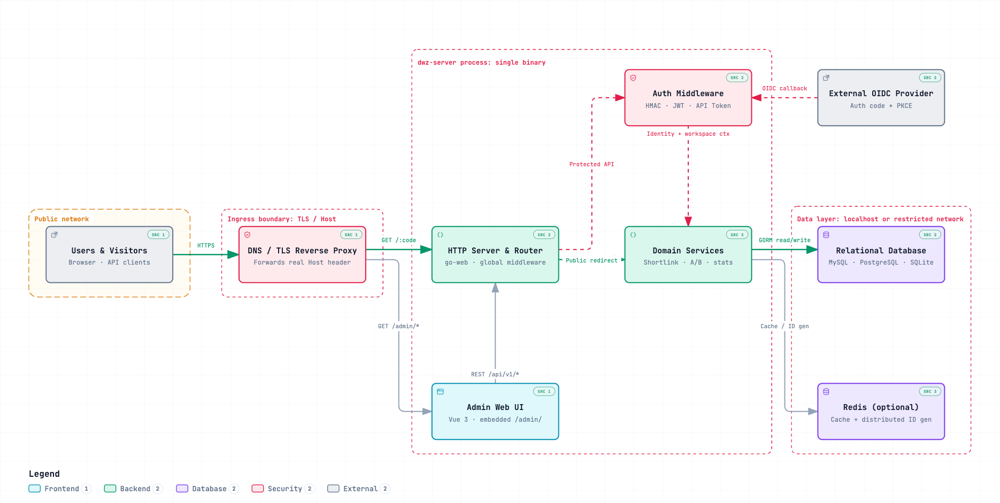
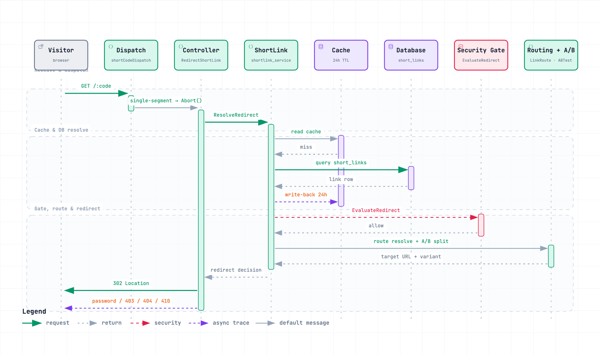

English | [简体中文](README.zh-CN.md)

<p align="center">
  
</p>

<h1 align="center">Muleiwu URL Shortener (dwz-server)</h1>

<p align="center">Self-hosted link management platform for teams</p>

<p align="center">
  <a href="https://go.dev/"></a>
  <a href="https://github.com/gin-gonic/gin"></a>
  <a href="https://gorm.io/"></a>
  <a href="https://github.com/muleiwu/dwz-server/releases"></a>
  <a href="./LICENSE"></a>
</p>

## Introduction

Muleiwu URL Shortener (dwz-server) combines short-link management, multi-domain support, access policies, A/B testing, marketing attribution, and click analytics in one self-hosted platform. The backend is written in Go; the Vue 3 + Ant Design Vue admin console ships inside the same binary or Docker image.

It runs standalone on SQLite with an in-memory cache and a local ID generator, or on MySQL/PostgreSQL plus Redis for production and multi-instance deployments.

> **Important:** before creating production short links, configure your public short domain's DNS, certificate, and reverse proxy. The app resolves links by the exact `Host + short code` it receives — if a proxy rewrites Host to an internal address, container name, or wrong port, the admin panel and health check stay green while public short links return 404. See the [first-use guide](https://mdoc.cc/mliev/dwz/v2.22.3/391) and the [aaPanel tutorial](https://mdoc.cc/mliev/dwz/v2.22.3/335) (both in Chinese).

> **License notice:** this project uses a custom license, not a standard open-source one. Commercial and non-commercial use is free within the terms, but you must retain copyright notices and may not redistribute derivative versions. Read [LICENSE](LICENSE) before using, modifying, or deploying.

## Features

- **Short links** — custom codes, expiry, enable/disable, 301/302/307/308 redirects, batch operations, duplicate-URL policies
- **Multi-domain management** — per-domain protocol and parameter passthrough, short-code generation strategies, WeChat/QQ anti-block interstitials, ICP filing info
- **Advanced routing** — route by country/province, device, browser, OS, language, Referer, and query params; priorities, condition groups, fallback URLs, rule testing
- **Link security** — access passwords, time windows, click caps, IP allow/blocklists, bot policy, URL rule scanning, security events and abuse reports
- **A/B testing** — multi-variant, even or weighted split with session consistency, click and conversion stats, signed feedback tokens with idempotent callbacks
- **Analytics** — per-click detail, unique IPs, geo, source, time, device, browser, OS, bot, UTM, and routing dimensions with CSV export
- **Workspaces & auth** — multi-workspace with owner/admin/member/viewer roles; JWT login, API bearer tokens, HMAC request signing, OIDC login and binding
- **Ops & branding** — install wizard, health checks, static assets and templates embedded in a single binary, brand name and logo, QR-code styling in the admin UI

See the [feature matrix](docs/feature-matrix.md) for the full capability list and the [roadmap](docs/feature-roadmap.md) for what's planned (QR codes are generated and downloaded client-side today, not persisted server-side).

## Architecture



The request lifecycle of a short-code visit — dispatch, cache fallback, security gate, and A/B split, ending in the 302 redirect:



Four diagrams, grounded in the repository code, are provided as interactive HTML in both Chinese and English (theme toggle, zoom, search, export):

| Diagram | 中文 | English |
| --- | --- | --- |
| System architecture | [system-architecture.html](docs/archify/zh-CN/system-architecture.html) | [system-architecture.html](docs/archify/en/system-architecture.html) |
| Startup assembly | [startup-assembly.html](docs/archify/zh-CN/startup-assembly.html) | [startup-assembly.html](docs/archify/en/startup-assembly.html) |
| Redirect sequence | [redirect-flow.html](docs/archify/zh-CN/redirect-flow.html) | [redirect-flow.html](docs/archify/en/redirect-flow.html) |
| Click statistics dataflow | [click-statistics.html](docs/archify/zh-CN/click-statistics.html) | [click-statistics.html](docs/archify/en/click-statistics.html) |

## Screenshots

<details>
<summary>Expand to view admin UI screenshots (UI language: Chinese)</summary>

**Dashboard with global access heatmap**


**Short-link management**


**Multi-dimensional analytics**


**A/B testing**


</details>

## Quick Start

| Scenario | Database | Cache | ID generator |
| --- | --- | --- | --- |
| Lightweight standalone | SQLite | memory | local |
| Standard production | MySQL / PostgreSQL | Redis | Redis |

### Docker

Create an empty directory with this `compose.yaml`:

```yaml
services:
  dwz-server:
    image: docker.cnb.cool/mliev/dwz/dwz-server:latest
    container_name: dwz-server
    restart: unless-stopped
    ports:
      - "8080:8080"
    environment:
      TZ: Asia/Shanghai
    volumes:
      - ./config:/app/config
      - ./data:/app/data
      - ./logs:/app/logs
```

```bash
mkdir -p config data logs
docker compose up -d
docker compose logs -f dwz-server
```

Open <http://localhost:8080> in a browser; a fresh install redirects to the setup wizard: (1) choose SQLite or enter an existing MySQL/PostgreSQL connection; (2) for standalone mode pick the memory cache and local ID generator (or enter Redis connection details); (3) create the first administrator. The wizard writes `config/config.yaml` and `config/install.lock`, runs migrations, and restarts the service. Keep all three mounted directories — `data` also stores uploaded brand logos.

```bash
# Health check
curl http://localhost:8080/health/simple

# Upgrade (back up config, data, and external databases first)
docker compose pull && docker compose up -d
```

### Binary release

Download the archive for your platform from [GitHub Releases](https://github.com/muleiwu/dwz-server/releases), extract it into a writable directory, then:

```bash
chmod +x dwz-server
./dwz-server start              # run in foreground
./dwz-server start --daemon     # daemon mode
./dwz-server status | restart | stop
```

Open <http://localhost:8080> after first start to complete installation; lightweight mode needs no database or Redis.

### Build from source

Environment requirements and build steps for frontend, backend, and all platforms are in the [build guide](docs/manual-build.md) (includes local development and tests). The admin console lives in the `admin-webui` submodule — clone with `--recurse-submodules`.

After installation the main config lives at `config/config.yaml`; environment variables override YAML values — see the [configuration reference](docs/configuration.md) (Chinese) for the full table.

## Documentation

| Topic | Links |
| --- | --- |
| Features & roadmap | [Feature matrix](docs/feature-matrix.md) · [Roadmap](docs/feature-roadmap.md) *(Chinese)* |
| API & auth | [API reference](docs/api/API_REFERENCE.md) · [Bearer token auth](docs/api/API_BEARER_AUTH.md) · [Signature auth](docs/api/API_SIGNATURE_AUTH.md) *(Chinese)* |
| Configuration | [Configuration reference](docs/configuration.md) · [config.yaml.example](config.yaml.example) · [Static assets & templates](docs/static-templates.md) *(Chinese)* |
| Build & operations | [Build guide](docs/manual-build.md) · [Migrations](MIGRATION.md) · [Dependency security](docs/dependency-security.md) *(Chinese)* |
| Structure & architecture | [Project structure](docs/project-structure.md) · [Diagram index](docs/archify/README.md) |
| Full documentation | [Muleiwu docs](https://mdoc.cc/mliev/dwz/v2.22.3) · [aaPanel tutorial](https://mdoc.cc/mliev/dwz/v2.22.3/335) *(Chinese)* |

## Contributing

Issues, documentation improvements, tests, and pull requests are welcome. Before submitting code, at minimum run:

```bash
gofmt -w <changed Go files>
go test ./...
```

Never modify published migrations — add same-named migration files in all three database dialect directories; see the [migration guide](MIGRATION.md) *(Chinese)*.

## Links

- **Server**: [CNB (primary)](https://cnb.cool/mliev/dwz/dwz-server) · [GitHub](https://github.com/muleiwu/dwz-server) · [Gitee](https://gitee.com/muleiwu/dwz-server)
- **Admin console**: [CNB](https://cnb.cool/mliev/dwz/dwz-admin-webui) · [GitHub](https://github.com/muleiwu/dwz-admin-webui) · [Gitee](https://gitee.com/muleiwu/dwz-admin-webui)
- **Community**: QQ group `1021660914` ([join](https://n3.ink/lmKc))

## License

Copyright © 2025 Hefei Muleiwu Information Technology Co., Ltd. The project permits commercial and non-commercial use within the license terms, requires retained copyright notices, and restricts re-licensing and redistribution of derivative versions. Full terms in [LICENSE](LICENSE).

Thanks to contributor [@bh1xaq](https://cnb.cool/bh1xaq) for their help.
