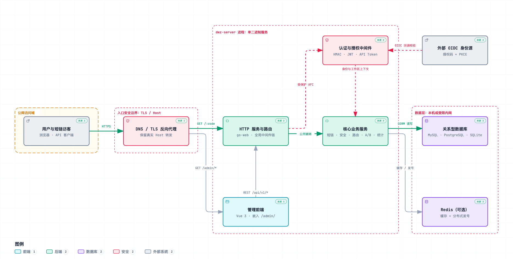
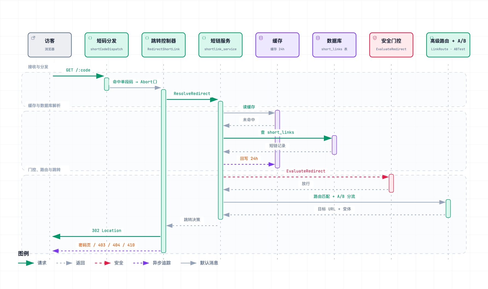

[English](README.md) | 简体中文

<p align="center">
  
</p>

<h1 align="center">木雷短网址（dwz-server）</h1>

<p align="center">面向团队与私有化部署的短链接管理平台</p>

<p align="center">
  <a href="https://go.dev/"></a>
  <a href="https://github.com/gin-gonic/gin"></a>
  <a href="https://gorm.io/"></a>
  <a href="https://github.com/muleiwu/dwz-server/releases"></a>
  <a href="./LICENSE"></a>
</p>

## 简介

木雷短网址（dwz-server）集短链生成、多域名、访问策略、A/B 测试、营销归因和统计分析于一体。服务端使用 Go 开发，管理端基于 Vue 3 与 Ant Design Vue，并随同一个二进制或 Docker 镜像分发。

项目既可以用 SQLite、内存缓存和本地发号器单机运行，也可以接入 MySQL/PostgreSQL 与 Redis，用于生产环境和多实例部署。

> **部署与首次使用的关键前置**：创建正式短链前，必须先配置公开短域名的 DNS、证书和反向代理。程序按实际收到的 HTTP `Host + 短码` 查找记录——Host 被改成内部地址、容器名或错误端口时，后台和健康检查可能一切正常，但公开短链仍会返回 404。详见[首次使用说明](https://mdoc.cc/mliev/dwz/v2.22.3/391)与[宝塔面板安装教程](https://mdoc.cc/mliev/dwz/v2.22.3/335)。

> **许可证提示**：本项目使用自定义许可证，不是标准开源协议。协议范围内可免费用于商业或非商业用途，但必须保留版权标识，且不得重新分发派生版本；使用前请阅读 [LICENSE](LICENSE)。

## 功能亮点

- **短链管理** — 自定义短码、过期时间、启停控制、301/302/307/308 跳转、批量操作、重复 URL 策略
- **多域名管理** — 每域名协议与参数透传、短码生成策略、微信/QQ 防红引导、站点备案信息
- **高级路由** — 按国家/省市、设备、浏览器、操作系统、语言、Referer、查询参数分流；支持优先级、条件组、兜底地址和规则测试
- **链接安全** — 访问密码、访问时间窗、最大访问次数、IP allowlist/blocklist、Bot 策略、URL 规则扫描、安全事件与滥用举报
- **A/B 测试** — 多变体、平均/权重分流、会话一致性、点击与转化统计、签名反馈 Token 与幂等回传
- **数据分析** — 点击明细、独立 IP、地域、来源、时间、设备、浏览器、OS、Bot、UTM 与路由维度分析，支持 CSV 导出
- **工作区与认证** — 多工作区与 owner/admin/member/viewer 四级角色；JWT 登录、API Bearer Token、请求签名、OIDC 登录与账号绑定
- **运维与品牌** — 首次安装向导、健康检查、单二进制内嵌静态资源与模板、品牌名称与 Logo、管理端二维码样式生成

完整能力清单见[功能矩阵](docs/feature-matrix.md)，规划中的能力见[功能路线图](docs/feature-roadmap.md)（二维码目前由管理端直接生成下载，尚未在服务端持久化）。

## 架构



短码访问的请求生命周期 —— 分发、缓存回源、安全门控与 A/B 分流，最终 302 跳转：



四张架构图以仓库代码为据绘制，提供中英双语交互式 HTML（明暗主题、缩放、搜索、导出）：

| 图 | 中文 | English |
| --- | --- | --- |
| 系统总体架构 | [system-architecture.html](docs/archify/zh-CN/system-architecture.html) | [system-architecture.html](docs/archify/en/system-architecture.html) |
| 启动装配流程 | [startup-assembly.html](docs/archify/zh-CN/startup-assembly.html) | [startup-assembly.html](docs/archify/en/startup-assembly.html) |
| 短码跳转时序 | [redirect-flow.html](docs/archify/zh-CN/redirect-flow.html) | [redirect-flow.html](docs/archify/en/redirect-flow.html) |
| 点击统计数据流 | [click-statistics.html](docs/archify/zh-CN/click-statistics.html) | [click-statistics.html](docs/archify/en/click-statistics.html) |

## 界面预览

<details>
<summary>展开查看管理端截图</summary>

**工作台与全球访问热力**


**短链接管理**


**多维统计分析**


**A/B 测试**


</details>

## 快速开始

| 场景 | 数据库 | 缓存 | ID 发号器 |
| --- | --- | --- | --- |
| 轻量单机 | SQLite | memory | local |
| 标准生产 | MySQL / PostgreSQL | Redis | Redis |

### Docker

创建空目录并写入以下 `compose.yaml`：

```yaml
services:
  dwz-server:
    image: docker.cnb.cool/mliev/dwz/dwz-server:latest
    container_name: dwz-server
    restart: unless-stopped
    ports:
      - "8080:8080"
    environment:
      TZ: Asia/Shanghai
    volumes:
      - ./config:/app/config
      - ./data:/app/data
      - ./logs:/app/logs
```

```bash
mkdir -p config data logs
docker compose up -d
docker compose logs -f dwz-server
```

浏览器打开 <http://localhost:8080>，未安装时会自动跳转安装向导：① 选择 SQLite 或填写已有 MySQL/PostgreSQL 连接；② 单机模式选内存缓存与本地发号器（使用 Redis 时填写连接）；③ 创建首个系统管理员。安装完成后生成 `config/config.yaml` 与 `config/install.lock`，执行迁移并自动重启；三个挂载目录需持续保留。

```bash
# 健康检查
curl http://localhost:8080/health/simple

# 升级（先备份配置、数据目录与外部数据库）
docker compose pull && docker compose up -d
```

### 二进制发布版

从 [GitHub Releases](https://github.com/muleiwu/dwz-server/releases) 下载对应平台压缩包，解压到可写目录后：

```bash
chmod +x dwz-server
./dwz-server start              # 前台运行
./dwz-server start --daemon     # 守护进程模式
./dwz-server status | restart | stop
```

首次启动后访问 <http://localhost:8080> 完成安装；轻量模式无需预装数据库或 Redis。

### 从源码构建

环境要求与前端、后端、多平台构建步骤见[手动构建文档](docs/manual-build.md)（含本地开发与测试）。管理端位于 `admin-webui` 子模块，克隆时使用 `--recurse-submodules`。

安装后主配置位于 `config/config.yaml`，同名环境变量会覆盖 YAML 取值——完整配置表见[配置说明](docs/configuration.md)。

## 文档

| 主题 | 链接 |
| --- | --- |
| 功能与路线图 | [功能矩阵](docs/feature-matrix.md) · [功能路线图](docs/feature-roadmap.md) |
| API 与认证 | [API 参考](docs/api/API_REFERENCE.md) · [Bearer Token 认证](docs/api/API_BEARER_AUTH.md) · [请求签名认证](docs/api/API_SIGNATURE_AUTH.md) |
| 配置 | [配置说明](docs/configuration.md) · [config.yaml.example](config.yaml.example) · [静态资源与模板](docs/static-templates.md) |
| 构建与运维 | [手动构建](docs/manual-build.md) · [迁移说明](MIGRATION.md) · [依赖安全记录](docs/dependency-security.md) |
| 项目结构与架构 | [项目结构](docs/project-structure.md) · [架构图目录](docs/archify/README.md) |
| 完整文档 | [木雷短网址文档](https://mdoc.cc/mliev/dwz/v2.22.3) · [宝塔面板安装教程](https://mdoc.cc/mliev/dwz/v2.22.3/335) |

## 参与贡献

欢迎提交 Issue、改进文档、补充测试或发起 Pull Request。提交代码前请至少执行：

```bash
gofmt -w <修改的 Go 文件>
go test ./...
```

请不要修改已发布的历史迁移；新的结构变更需在三个数据库方言目录中添加同名迁移文件，详见[迁移说明](MIGRATION.md)。

## 相关地址

- **服务端**：[CNB（主仓库）](https://cnb.cool/mliev/dwz/dwz-server) · [GitHub](https://github.com/muleiwu/dwz-server) · [Gitee](https://gitee.com/muleiwu/dwz-server)
- **管理端**：[CNB](https://cnb.cool/mliev/dwz/dwz-admin-webui) · [GitHub](https://github.com/muleiwu/dwz-admin-webui) · [Gitee](https://gitee.com/muleiwu/dwz-admin-webui)
- **交流**：QQ 群 `1021660914`（[点击加入](https://n3.ink/lmKc)）

## 许可证

版权所有 © 2025 合肥木雷坞信息技术有限公司。本项目在许可协议范围内允许商业或非商业使用，但要求保留版权标识，并限制再授权与派生版本再分发，完整条款以 [LICENSE](LICENSE) 为准。

感谢贡献者 [@bh1xaq](https://cnb.cool/bh1xaq) 对项目的帮助。
